<div align="center">


# Scam Detector

**A Chrome extension that warns you before a scam website gets your passwords, card details or money.**

[](https://chromewebstore.google.com/detail/scam-detector/lgppgajjfgffahljkkgcnjjelnbgjaod)
[](manifest.json)
[](https://github.com/neteinstein/Scam-Detector/actions/workflows/ci.yml)
[](https://github.com/neteinstein/Scam-Detector/releases/latest)
[](_locales/)
[](#development)
[](package.json)

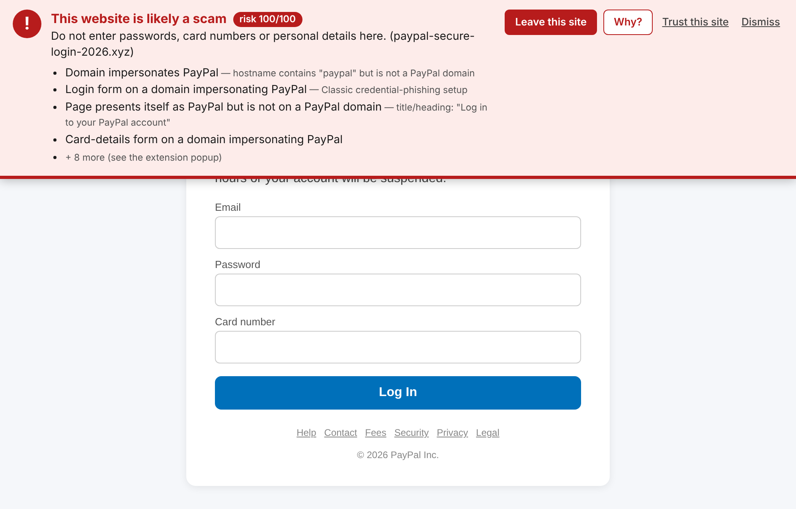

*A fake PayPal login on a look-alike domain. The banner explains why, in plain words, and offers a one-click way out.*

**[Add it to Chrome from the Chrome Web Store](https://chromewebstore.google.com/detail/scam-detector/lgppgajjfgffahljkkgcnjjelnbgjaod)**, free.

</div>

## Watch: 25 seconds, in plain words

<a href="docs/video/scam-detector-en.mp4">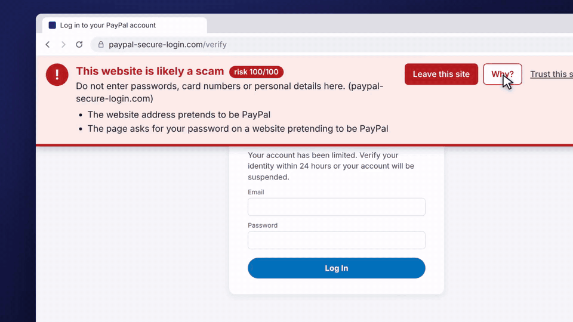</a>

*It plays above without sound. Click it for the full video with music.* A fake "your account has been limited" text, the warning that appears when the link is opened, a marketplace chat scam, and the honest part: it will miss some scams, so stay alert. Made for people who are not technical, so share it with parents and grandparents.

🇵🇹 **Em português:** [vídeo](docs/video/scam-detector-pt.mp4) com a burla da encomenda dos CTT. Share text and how to re-render: [`docs/video/`](docs/video/README.md).

---

## What it does

Every page you open is scored from 0 to 100 for the traces scams leave behind: a domain registered days ago, a brand name hidden in the address, a login form that posts somewhere else, a logo hot-linked from the real company, the wording of a "your account has been suspended" page, a courier that will "collect the item and pay you by link". When the score crosses a threshold a banner appears at the top of the page:

| Score | Banner | Meaning |
| --- | --- | --- |
| **60 – 100** | 🔴 **This website is likely a scam** | Several strong, independent indicators. Do not enter anything. |
| **35 – 59** | 🟠 **This website looks suspicious** | Some indicators. Look closer before trusting it. |
| 0 – 34 | none | The popup shows the score and lists any minor observations. |

The toolbar shield itself changes colour, with no number on it: 🟢 green with ✓ when nothing was found, 🟡 yellow when there are minor signals, 🔴 red when a warning banner is showing, grey with ✓ on a site you trust, and blue-grey on pages that were not checked.

> **Do not trust it blindly.** Scam Detector recognises the traces of known scams. It will miss some, and it will most likely miss new schemes nobody has identified yet. No warning does not mean safe. A welcome page says this on first install.

Everything runs inside the browser. The only network traffic is a domain-registration lookup (domain name only), a periodic download of PhishTank's public reports feed, and, once you enter your own API key, a Google Safe Browsing check (on by default, inactive without a key). See [Privacy](#privacy).

## Scenarios

<table>
<tr>
<td width="50%">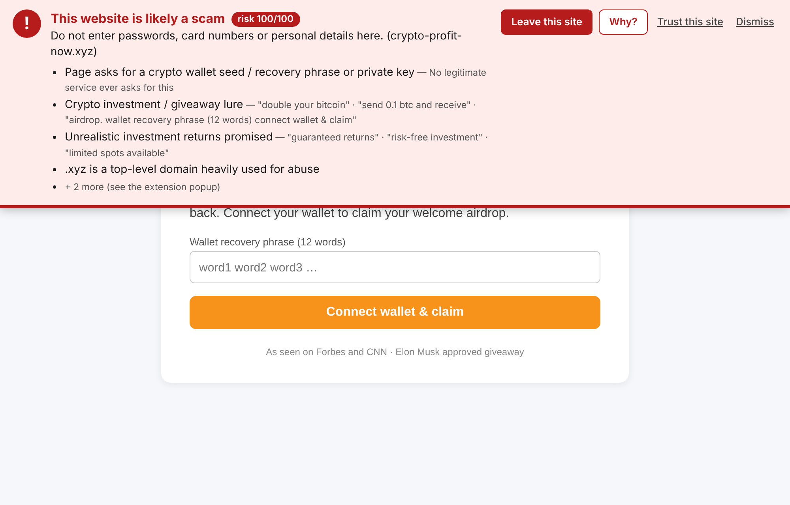<br><b>Crypto "double your Bitcoin" page.</b> Seed-phrase field, guaranteed-returns wording, airdrop lure and a cheap TLD stack up to a red banner.</td>
<td width="50%">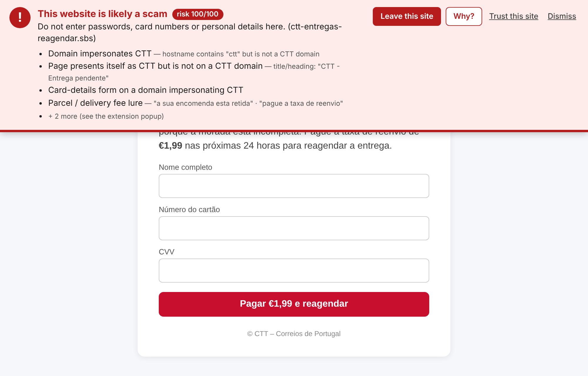<br><b>Parcel-fee scam in Portuguese.</b> A CTT look-alike domain asking for card details to "reschedule delivery" for €1,99. Wording is matched in Portuguese, Spanish, French and English.</td>
</tr>
<tr>
<td>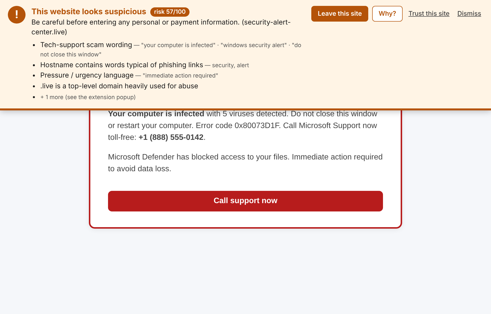<br><b>Tech-support scare page.</b> "Your computer is infected, call now" plus urgency and a phishing-style hostname lands in the amber range.</td>
<td>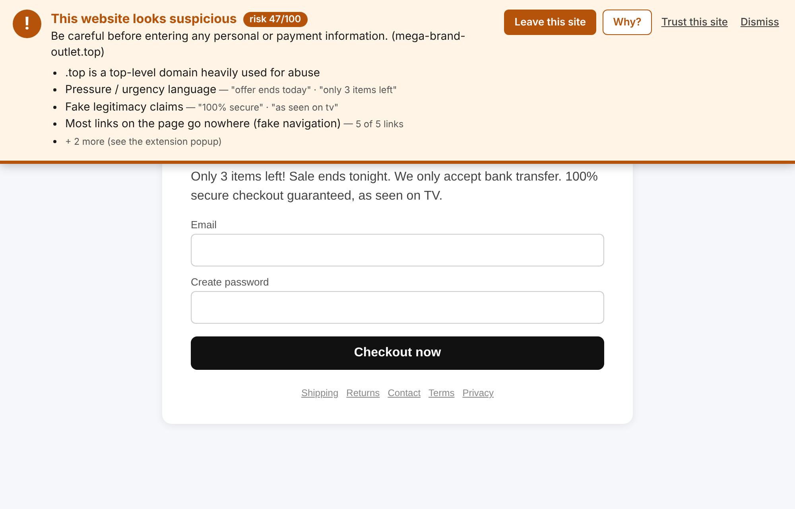<br><b>Too-good-to-be-true shop.</b> "Offer ends today, only 3 left, bank transfer only, as seen on TV" on a .top domain with dead navigation: suspicious, not yet condemned.</td>
</tr>
<tr>
<td>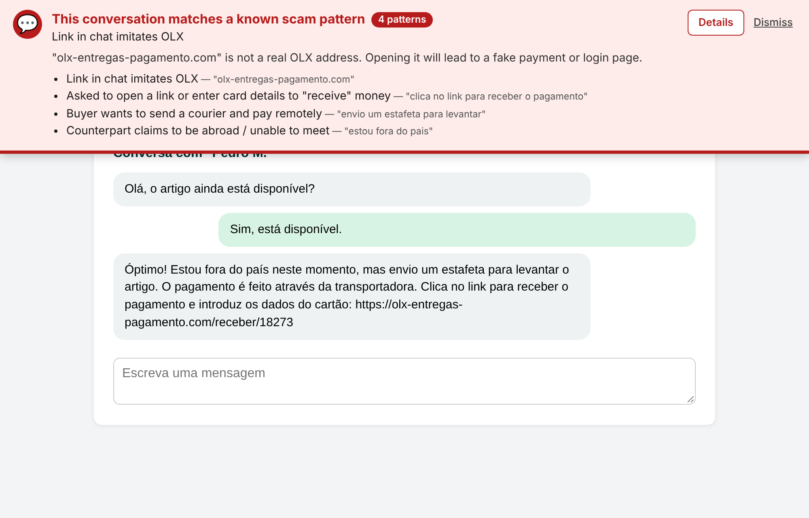<br><b>Marketplace chat monitor (on by default).</b> On OLX, Vinted, Wallapop, Leboncoin and ~100 other classified sites, the classic "I'm abroad, my courier will collect it, click the link to receive the payment" script is recognised in the conversation itself, including the fake OLX payment link.</td>
<td>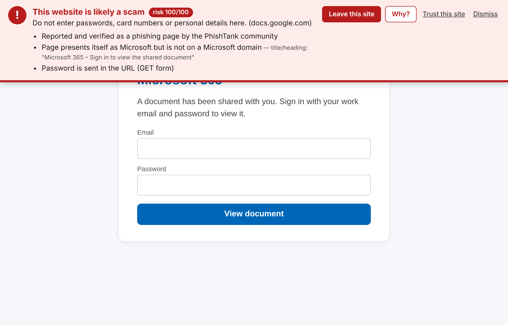<br><b>Verified phishing report on a shared host.</b> A credential-harvesting form hosted on Google Forms is flagged because that exact page is in PhishTank's verified feed, matched locally. Other Google Docs pages stay trusted.</td>
</tr>
</table>

### In your language

The interface follows the browser language. Every banner, button, popup line, settings text, signal explanation and chat-scam advice ships in **English, Portuguese, Spanish and French** (`_locales/`), and the same four languages are used for detecting scam wording on pages and in chats.

<table>
<tr>
<td width="50%">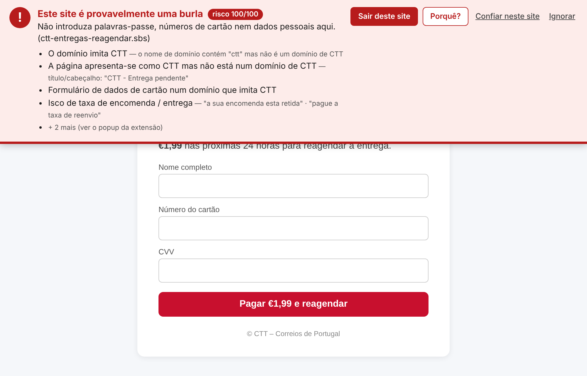<br><b>Português.</b> The CTT parcel-fee scam with the banner and explanations in Portuguese.</td>
<td width="50%">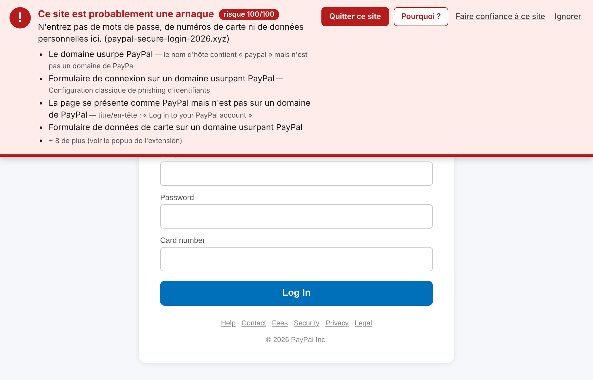<br><b>Français.</b> The fake PayPal login seen from a French browser.</td>
</tr>
</table>

<table>
<tr>
<td width="33%">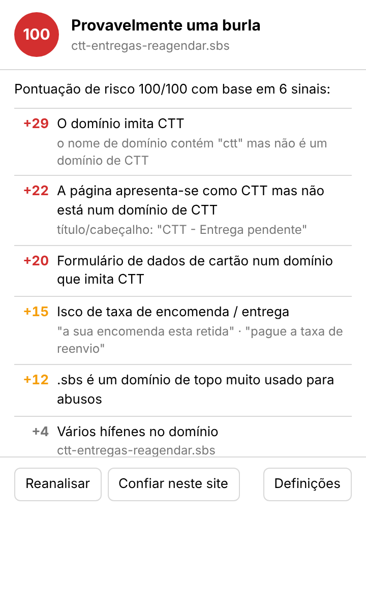<br><b>Popup, Portuguese.</b></td>
<td width="33%">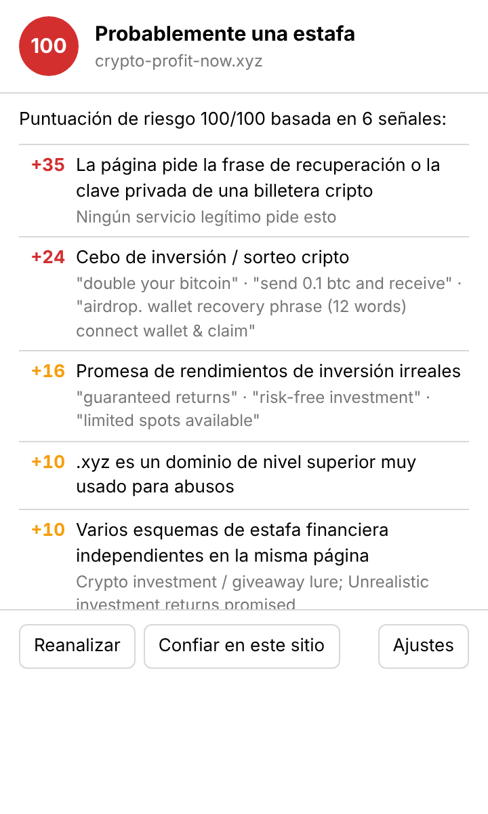<br><b>Popup, Spanish.</b></td>
<td width="33%">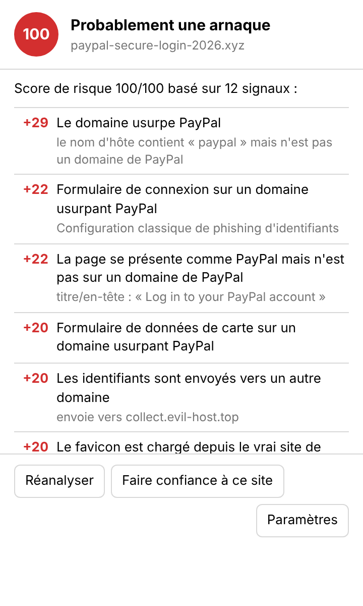<br><b>Popup, French.</b></td>
</tr>
</table>

### Popup and settings

<table>
<tr>
<td width="33%">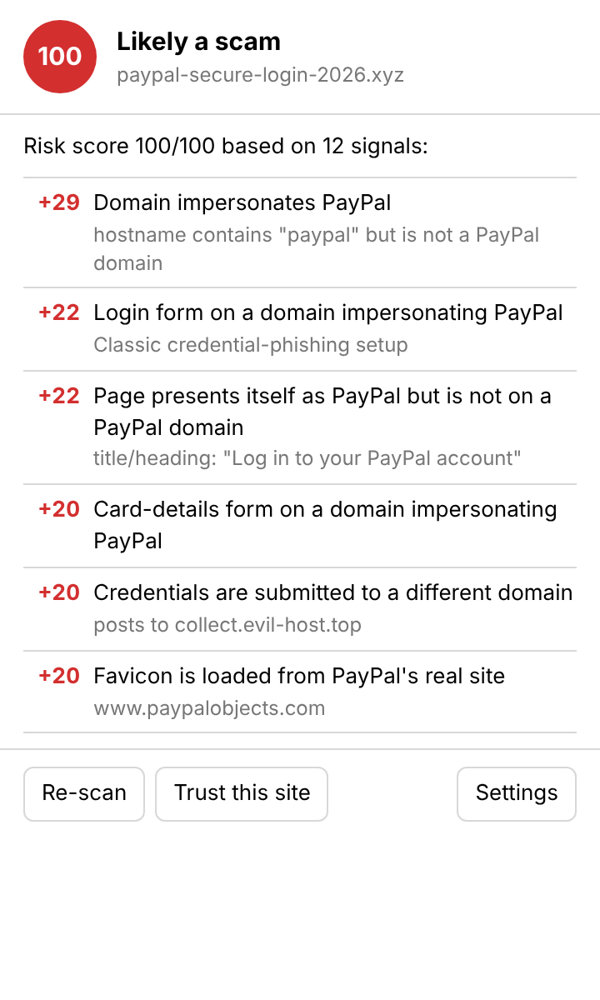<br><b>Every finding with its weight.</b> Click the toolbar icon to see what contributed to the score.</td>
<td width="33%">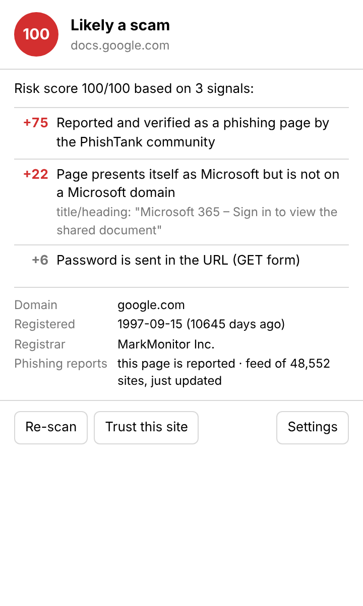<br><b>Reputation sources in the popup.</b> PhishTank feed status and, when enabled, the Safe Browsing answer.</td>
<td width="33%">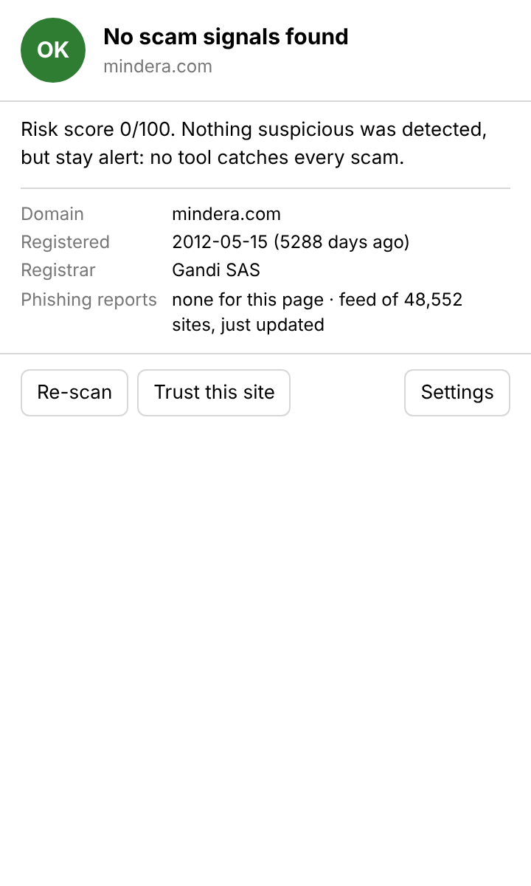<br><b>Clean site.</b> Score 0, registration date from RDAP, nothing to worry about.</td>
</tr>
</table>

<details>
<summary><b>Settings page</b> (thresholds, reputation sources, chat monitor, trusted domains, custom brands)</summary>
<br>
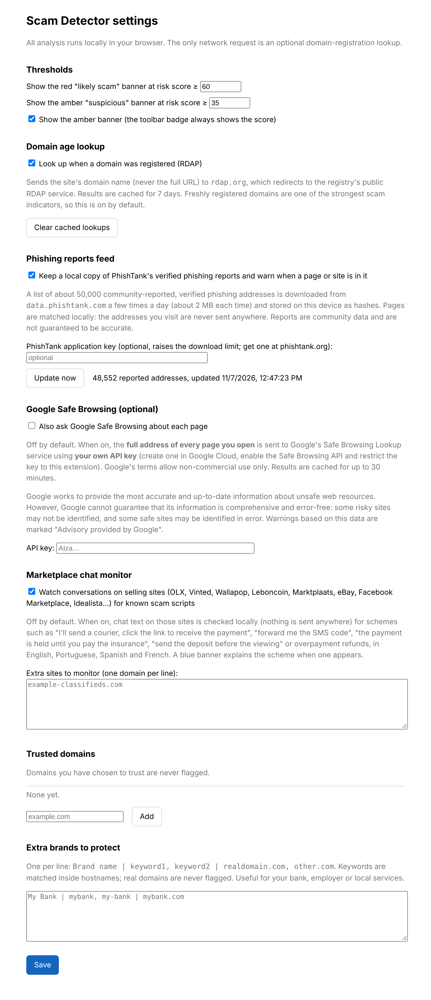
</details>

## How it works

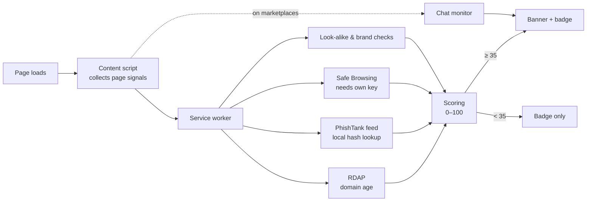

Each observation becomes a weighted **signal**; weights add up, strong independent signals reinforce each other, and the total is clamped to 100. Pages on the real domains of known brands, on local networks and on domains you trust are never flagged, with one exception: a verified phishing report for the exact page overrides the brand shortcut, so phishing hosted on Google Docs or Dropbox still warns.

<details>
<summary><b>Domain-level signals</b></summary>

| Signal | Description | Weight |
| --- | --- | --- |
| Domain age | Registration date via RDAP. < 7 days: 35, < 30 days: 30, < 90: 22, < 180: 14, < 1 year: 8 | up to 35 |
| Brand impersonation | The hostname contains, typosquats or homoglyph-mimics one of ~180 commonly impersonated brands (banks, payments, crypto, couriers, tax authorities, telecoms, marketplaces, big tech) and is **not** one of that brand's real domains. Covers `paypal-secure-login.com`, `paypa1.com`, `secure.paypal.com.evil.net`, `gooogle.com`, `xn--pypal-4ve.com` (Cyrillic а), `micros0ft-support.live`, `amazon-de.top` | 28–35 |
| IDN / punycode | Non-Latin hostname without a brand match | 10 |
| Raw IP host | Site addressed by IP instead of a name | 25 |
| Risky TLD | TLDs with a very high abuse share (`.zip`, `.top`, `.xyz`, `.tk`, `.icu`, `.sbs`, …) | 4–14 |
| Phishing words in hostname | `login`, `verify`, `secure`, `account`, `redelivery`, `airdrop`, … | 6 each, max 18 |
| Structure | Many hyphens, deep subdomains, very long host, mixed digits, random-looking names | 4–8 each |
| No HTTPS | Unencrypted page; much worse if it asks for credentials | 10 / 25 |

</details>

<details>
<summary><b>Reputation sources</b></summary>

| Signal | Description | Weight |
| --- | --- | --- |
| Verified phishing report | The page (or a path prefix of it) is in PhishTank's verified-online feed. A local copy (~50k addresses, refreshed every 6 hours, stored as truncated SHA-256 hashes) is matched in the browser, so visited URLs never leave the device. On shared platforms (Google Docs/Sites, link shorteners, form builders, free hosting) only exact-page matches count | 75 |
| Phishing reports on this host | The host has verified reports and is not a shared platform | 45 |
| Google Safe Browsing (on by default, needs a key) | With your own API key, the Lookup API is asked about each page. Warnings carry the "Advisory provided by Google" attribution and the links Google's terms require; answers are cached at most 30 minutes | 75 |

</details>

<details>
<summary><b>Page-level signals</b></summary>

| Signal | Description | Weight |
| --- | --- | --- |
| Credential / card form in a bad context | Password or card field on a look-alike domain, a days-old domain, a free hosting sandbox, or an IP host | 12–22 |
| Seed phrase request | Input asking for a wallet recovery phrase / private key | 35 |
| Cross-domain submission | Credentials posted to a different registrable domain, or over plain HTTP | 20 |
| Brand mismatch | Page title / heading / copyright claims to be a brand the domain does not belong to (ambiguous names like *Apple*, *Chase*, *Visa* need an account/login context) | 10, 22 with a form |
| Hot-linked brand assets | Favicon or logos loaded from the real brand's servers | 15–20 |
| Social-engineering language | Urgency, prizes, tech-support alerts, parcel-fee lures, fake "100% safe" claims | 5–15 per category |
| Money claims | Templates of well-known money frauds: unrealistic investment returns, advance fees to "release" funds, no-credit-check loans with upfront fees, job offers that charge a registration fee, overpayment refunds, lottery / inheritance / unclaimed funds, fake escrow, crypto doubling, gift-card-only payment, tiny "verification fees" | 8–14 per category |
| Money claims + a way to take your money | Card or account form next to money claims, several fraud templates on one page, money claims on a days-old or free-hosted site | up to 32 |
| Fake navigation / deceptive links | Most links go nowhere; link text shows one domain, `href` another | 6–12 |
| Misc | Right-click disabled on a login page, decorative "secure" badges, auto-redirect to another domain, many third-party frames | 5–8 |

All language signals together are capped at 40 points. Patterns exist in **English, Portuguese, Spanish and French**, matched accent-insensitively.

</details>

<details>
<summary><b>Marketplace chat schemes</b> (on by default)</summary>

| Scheme | Typical message |
| --- | --- |
| Courier pick-up | "I'm abroad, I'll send a courier to collect it, the transport company pays you" |
| Payment link / card details to *receive* money | "Click the link to receive the payment and enter your card details" |
| Look-alike link | A link in the chat whose domain imitates the marketplace or a payment brand |
| Fee to release the money | "The payment is held by the platform until you pay the transport insurance" |
| Forward the SMS code | "Send me the verification code you just received" |
| Overpayment | "I sent too much by mistake, refund the difference" |
| Rental deposit before viewing | "Pay the deposit first, the keys will be sent by courier, Airbnb will handle it" |
| Fake payment proof / upgrade | "I've paid, see the screenshot. It's pending until you upgrade to a business account" |
| Pay upfront via untraceable channel | "Bank transfer / MB WAY / Bizum / PayPal friends & family / gift cards first, then I ship" |
| Off-platform + abroad + pressure | Weak alone, an alert together |

The chat text never leaves the browser. On sites without a recognisable chat area, only the strong schemes are applied to the page text.

</details>

## Install

**[Install Scam Detector from the Chrome Web Store](https://chromewebstore.google.com/detail/scam-detector/lgppgajjfgffahljkkgcnjjelnbgjaod)**, the easiest way, with automatic updates.

To install a specific build by hand instead, use the
[Releases page](https://github.com/neteinstein/Scam-Detector/releases/latest):

1. Download `scam-detector-<version>.zip` and unzip it (check it against `SHA256SUMS.txt` if you like).
2. Open `chrome://extensions`, enable **Developer mode** (top right).
3. Click **Load unpacked** and select the unzipped folder (the one containing `manifest.json`).

Developers can load the repository folder directly the same way.

The shield icon shows the risk score of the current tab (red, amber, or a green tick for known and trusted sites). Click it for the full list of findings, to re-scan, or to trust a site.

## Settings

Open the popup → **Settings**:

- **Non-tech terms** (on by default): every warning and setting in simple words; off shows the technical wording.
- Danger / warning thresholds, and whether the amber banner is shown.
- RDAP domain-age lookup on/off and cache clearing.
- Phishing-reports feed on/off, optional PhishTank app key, manual update.
- Google Safe Browsing on/off (on by default; it only runs once you enter your own API key — restrict the key to the extension's origin in Google Cloud).
- Marketplace chat monitor on/off (on by default) and extra sites to monitor.
- Trusted domains.
- **Extra brands to protect**, one per line: `Name | keyword1, keyword2 | realdomain.com`.
- **About**: version, author ([pedrovicente.pt](https://pedrovicente.pt)), feedback link, and donations via [Revolut](https://revolut.me/neteinstein) or [Buy me a beer](https://www.buymeacoffee.com/neteinstein).

## Privacy

| Data | Where it goes | Default |
| --- | --- | --- |
| Registrable domain name (never the URL or page content) | `rdap.org`, which redirects to the domain's registry, to learn the registration date. Cached 7 days | on, can be disabled |
| Nothing about you | `data.phishtank.com`: the extension *downloads* the public reports feed a few times a day. Matching is local | on, can be disabled |
| Full page URL | `safebrowsing.googleapis.com`, only if you enable it and provide your own key | **off** |
| Page content, chat text, settings | Processed in memory; settings sync via Chrome; per-tab results live in session storage | never sent |

No analytics, no accounts, no remote code. The full policy is in [`store-listing/privacy-policy.md`](store-listing/privacy-policy.md).

## Development

```
npm test               # unit tests + store-listing consistency check + catalogue report
npm run e2e            # loads the extension into Chromium with Playwright and checks every scenario
npm run icons          # regenerate icons/*.png
npm run package        # dist/scam-detector-<version>.zip, runtime files only
npm run store-assets   # regenerate store-listing/assets/*.png (1280×800 screenshots, promo tiles)
node tools/docs-screenshots.js   # regenerate the README screenshots in docs/
node tools/catalogue-report.js [--feed online-valid.csv]   # catalogue stats, stale-review warning, brands missing vs. PhishTank targets
```

No build step and no runtime dependencies. The library files use a tiny UMD wrapper so the same code runs in the service worker (`importScripts`), in content scripts and under Node for tests.

```
manifest.json
src/background.js      service worker: RDAP lookup, PhishTank feed, Safe Browsing, scoring, badge, messaging
src/content.js         collects page observations, chat monitor, renders the banners (closed shadow DOM)
src/lib/domain.js      hostname parsing (compact public-suffix subset), Levenshtein, entropy
src/lib/punycode.js    IDN decoding
src/lib/brands.js      impersonated-brand catalogue
src/lib/lookalike.js   typosquat / homoglyph / embedded-brand detection
src/lib/tlds.js        TLD risk weights
src/lib/phrases.js     scam language + money-claim patterns (en/pt/es/fr, accent-insensitive)
src/lib/chatSchemes.js marketplace chat scam scripts (en/pt/es/fr) and marketplace list
src/lib/urlmatch.js    phishing-feed index (hashed) and local URL/host matching
src/lib/i18n.js        chrome.i18n wrapper; signals and chat schemes carry message keys
_locales/              UI strings in en, pt, es, fr
src/lib/pageSignals.js DOM observation collector
src/lib/scoring.js     signals → score → verdict
popup/, options/       UI
tools/                 icon generator, packager, screenshot generators, catalogue report, e2e script
test/                  unit tests
catalogue/             review log for the scam catalogue
.github/workflows/     CI and release pipelines
store-listing/         Chrome Web Store submission kit
.claude/skills/        update-scam-catalogue skill
```

### Keeping the catalogue current

Detection is only as good as the lists it ships. The `update-scam-catalogue` skill ([`.claude/skills/update-scam-catalogue/SKILL.md`](.claude/skills/update-scam-catalogue/SKILL.md)) walks an agent through reviewing current reports from Banco de Portugal, PJ, CNCS, DECO, INCIBE, cybermalveillance.gouv.fr, Action Fraud, the FTC, APWG, Spamhaus and PhishTank's own target statistics, adding what is missing with tests in all four languages, and logging the review in [`catalogue/last-review.json`](catalogue/last-review.json). [`AGENTS.md`](AGENTS.md) requires it before finishing any change, and `npm test` warns when the last review is older than 30 days.

## Build pipeline

Two GitHub Actions workflows in `.github/workflows/`:

- **CI** (`ci.yml`) runs on every push and pull request: unit tests, the store-listing consistency check, the catalogue report, a package build attached as an artifact, and the Playwright end-to-end scenarios in Chromium with their screenshots.
- **Release** (`release.yml`) runs on every push to `main` (or on manual dispatch). If no tag exists for the manifest version it runs the tests, builds `scam-detector-<version>.zip`, writes `SHA256SUMS.txt`, takes the release notes from the *What's new* section of `store-listing/listing.md`, tags `v<version>` and publishes a GitHub Release with the zip and install instructions. Bumping the version is therefore the whole release procedure; pushes that do not bump it are a no-op.

## Publishing to the Chrome Web Store

The extension is live at [https://chromewebstore.google.com/detail/scam-detector/lgppgajjfgffahljkkgcnjjelnbgjaod](https://chromewebstore.google.com/detail/scam-detector/lgppgajjfgffahljkkgcnjjelnbgjaod). Everything for the submission is in [`store-listing/`](store-listing/README.md): listing text, permission justifications, privacy policy (Markdown and a hostable HTML copy), data-usage answers, distribution notes and generated screenshots and promo tiles. `npm run package` builds the upload zip; `npm run check-listing` (part of `npm test`) fails when the kit disagrees with the code, and `AGENTS.md` tells coding agents to update the kit in the same commit as any change that affects it.

## Third-party sources and their terms

Only sources whose published terms allow this use are called. PhishTank data is free to use, including commercially, per its published terms; Google Safe Browsing is free for non-commercial use with attribution. ScamAdviser (paid B2B API only), ScamWise and ScamChecker.app (terms prohibit automated access), OpenPhish (non-commercial, no redistribution) and the VirusTotal public API (no products) are deliberately not used.

## Limitations

- Heuristics, not a blocklist: a well-made scam on an old domain with careful wording can score low, and an aggressive marketing page on a cheap TLD can score amber. Treat the banner as a prompt to look closer, not a verdict.
- Some registries (notably `.de` and many ccTLDs) do not publish registration dates over RDAP, so domain age is unknown there.
- The public-suffix list is a curated subset; unusual multi-label suffixes may be split incorrectly.
- Chat-area detection relies on generic markup; on unusual sites only the strong schemes apply to the whole page.
- Known catalogue gaps: Imovirtual, Standvirtual, Continente, Pingo Doce, Worten, Via Verde and the MB WAY request-versus-send chat pattern.

## License

MIT
