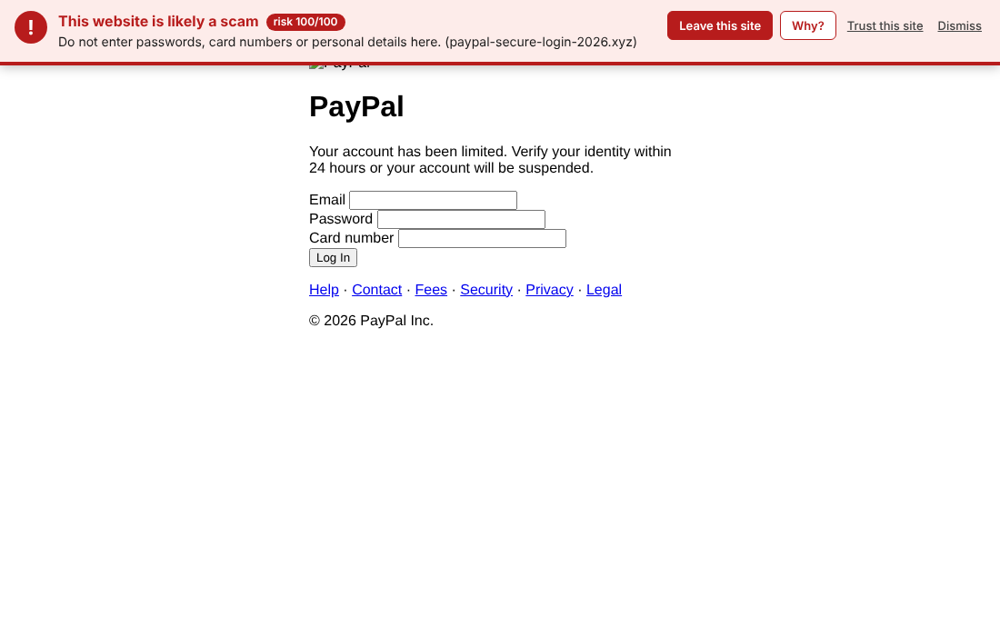

# Scam Detector

A Chrome extension (Manifest V3) that inspects every page you visit for the tell-tale
traces of a scam and shows a warning banner at the top of the page when the risk is high.



Everything runs locally in the browser. The only network request is an optional
lookup of the domain's registration date (see [Privacy](#privacy)).

## Install (unpacked)

1. Clone this repository.
2. Open `chrome://extensions`, enable **Developer mode** (top right).
3. Click **Load unpacked** and select the repository folder (the one containing `manifest.json`).

The shield icon shows the risk score of the current tab as a badge (red = likely scam,
amber = suspicious, green tick = known / trusted site). Click it for the full list of
signals, to re-scan, or to trust a site.

## What it looks at

Each observation becomes a weighted *signal*; the weights add up to a 0–100 risk
score. Independent strong signals reinforce each other. Default thresholds:
**≥ 60 → red "likely a scam" banner**, **≥ 35 → amber "suspicious" banner**.

### Domain-level signals

| Signal | Description | Weight |
| --- | --- | --- |
| Domain age | Registration date via RDAP. < 7 days: 35, < 30 days: 30, < 90: 22, < 180: 14, < 1 year: 8 | up to 35 |
| Brand impersonation | The hostname contains, typosquats or homoglyph-mimics one of ~130 commonly impersonated brands (banks, payments, crypto, couriers, tax authorities, big tech) and is **not** one of that brand's real domains. Covers `paypal-secure-login.com`, `paypa1.com`, `secure.paypal.com.evil.net`, `gooogle.com`, `xn--pypal-4ve.com` (Cyrillic а), `micros0ft-support.live`, `amazon-de.top`… | 28–35 |
| IDN / punycode | Non-Latin hostname without a brand match | 10 |
| Raw IP host | Site addressed by IP instead of a name | 25 |
| Risky TLD | TLDs with a very high abuse share (`.zip`, `.top`, `.xyz`, `.tk`, `.icu`, `.sbs`, …) | 4–14 |
| Phishing words in hostname | `login`, `verify`, `secure`, `account`, `redelivery`, `airdrop`, … | 6 each, max 18 |
| Structure | Many hyphens, deep subdomains, very long host, mixed digits, random-looking names | 4–8 each |
| No HTTPS | Unencrypted page; much worse if it asks for credentials | 10 / 25 |

### Page-level signals

| Signal | Description | Weight |
| --- | --- | --- |
| Credential / card form in a bad context | Password or card field on a look-alike domain, a days-old domain, a free hosting sandbox, or an IP host | 12–22 |
| Seed phrase request | Input asking for a wallet recovery phrase / private key | 35 |
| Cross-domain submission | Credentials posted to a different registrable domain, or over plain HTTP | 20 |
| Brand mismatch | Page title / heading / copyright claims to be a brand the domain does not belong to (ambiguous names like *Apple*, *Chase*, *Visa* need an account/login context) | 10, 22 with a form |
| Hot-linked brand assets | Favicon or logos loaded from the real brand's servers (phishing kits do this) | 15–20 |
| Social-engineering language | Urgency ("account suspended, verify within 24 hours"), prizes, crypto doubling / airdrops, tech-support alerts with phone numbers, gift-card-only payment, parcel-fee lures, tiny "verification fees". English, Portuguese and Spanish patterns | 5–15 per category, max 30 |
| Fake navigation | Most links go to `#` / `javascript:` | 8 |
| Deceptive links | Link text shows one domain, `href` goes to another | 6–12 |
| Misc | Right-click disabled on a login page, decorative "secure" badges, auto-redirect to another domain, many third-party frames | 5–8 |

Pages on the real domains of known brands, on `localhost` / private networks, and on
domains you trust are never flagged. Phishing kits often inject the login form after
load, so the page is re-scanned on DOM changes for the first 45 seconds.

## Settings

Open the popup → **Settings** (or the extension's options page):

- Danger / warning thresholds, and whether the amber banner is shown.
- Toggle the RDAP domain-age lookup and clear its cache.
- Trusted domains list.
- **Extra brands to protect**: add your own bank, employer or local services as
  `Name | keyword1, keyword2 | realdomain.com`. Keywords are matched inside hostnames and
  page titles, real domains are never flagged.

## Privacy

- No browsing data leaves the browser except the **registrable domain name** (never the
  URL, never page content) sent to `https://rdap.org/domain/<domain>`, which redirects to
  the registry's public RDAP service to find the registration date. Results are cached
  locally for 7 days. This can be switched off in settings.
- No analytics, no remote blocklists, no accounts.
- Settings sync through `chrome.storage.sync`; per-tab results live in session storage only.

## Development

```
npm test        # unit tests (node --test), no dependencies needed
npm run e2e     # loads the extension into Chromium with Playwright and checks the banner
npm run icons   # regenerate icons/*.png
```

Layout:

```
manifest.json
src/background.js      service worker: RDAP lookup + cache, scoring, badge, messaging
src/content.js         collects page observations, renders the banner (closed shadow DOM)
src/lib/domain.js      hostname parsing (compact public-suffix subset), Levenshtein, entropy
src/lib/punycode.js    IDN decoding
src/lib/brands.js      impersonated-brand catalogue
src/lib/lookalike.js   typosquat / homoglyph / embedded-brand detection
src/lib/tlds.js        TLD risk weights
src/lib/phrases.js     scam language patterns (en/pt/es)
src/lib/pageSignals.js DOM observation collector
src/lib/scoring.js     signals → score → verdict
popup/, options/       UI
tools/                 icon generator and Playwright e2e script
test/                  unit tests
```

The library files use a tiny UMD wrapper so the same code runs in the service worker
(`importScripts`), in content scripts and under Node for tests, with no build step.

## Limitations

- Heuristics, not a blocklist: a well-made scam on an old domain with careful wording can
  score low, and an aggressive marketing page on a cheap TLD can score in the amber range.
  Treat the banner as a prompt to look closer, not a verdict.
- Some registries (notably `.de`, many ccTLDs) do not publish registration dates over
  RDAP, so domain age is unknown there.
- The public-suffix list is a curated subset; unusual multi-label suffixes may be split
  incorrectly (this only affects which part of the host is treated as the "domain").
- Brand coverage is a curated list; add your own in settings.
